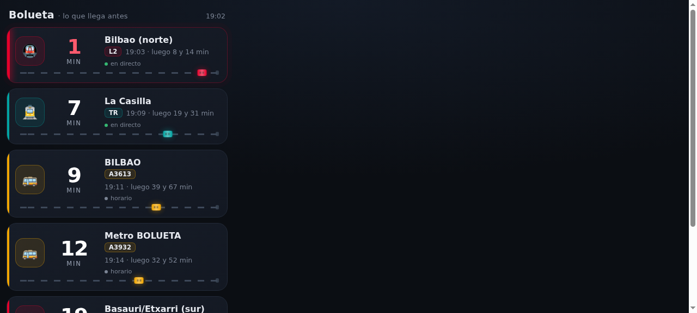

# Bilbao Transit para Home Assistant

[](https://github.com/RickAndMe/ha-bilbao-transit/releases)
[](https://hacs.xyz)
[](https://github.com/RickAndMe/ha-bilbao-transit/actions/workflows/validate.yml)
[](LICENSE)

**Cuánto falta para el próximo metro, tranvía o bus, desde tu parada de siempre y
dentro de Home Assistant.** Sin abrir otra app, sin publicidad y sin claves de API:
solo datos abiertos oficiales (Consorcio de Transportes de Bizkaia y Open Data Euskadi).

<p align="center">
  
</p>

## Qué te da

- **Metro Bilbao, Euskotren Tranvía, Bizkaibus y Bilbobus** en el mismo sitio.
- Un sensor por parada y sentido (o por línea y sentido, en los buses) cuyo **estado son
  los minutos que faltan**. Perfecto para tarjetas, automatizaciones y avisos al móvil.
- **Cada salida con su destino final y su línea**: en el metro no basta con "sentido
  Kabiezes", porque ese tren puede acabar en Plentzia, Bidezabal o Ibarbengoa.
- Elige la parada **por cercanía a tu casa**: el alta te las ordena por distancia.
- Te dice **de dónde sale el dato**: estimación oficial en tiempo real (🟢) o horario
  programado (⚪). Nunca te vende horario como si fuera tiempo real.

## Cobertura real del dato

| Red | Horario oficial | Tiempo real | Notas |
| --- | :---: | :---: | --- |
| **Metro Bilbao** | ✅ | 🟢 Sí | El feed oficial no dice el sentido ni la línea: se deducen cruzando con el horario. |
| **Euskotren Tranvía** | ✅ | 🟢 Sí | El feed distingue andén en cada parada. |
| **Bizkaibus** | ✅ | 🟡 Parcial | El feed solo publica la **próxima parada** de cada autobús: verás el que está llegando y, para el resto, el horario. |
| **Bilbobus** | ✅ | ❌ No | No publica estimaciones (solo posiciones de vehículos, y a menudo vacías). Va con horario programado y lo indica. |

## Instalación

### Por HACS (recomendado)

1. Abre **HACS** en Home Assistant.
2. Menú de tres puntos → **Repositorios personalizados**.
3. Añade `https://github.com/RickAndMe/ha-bilbao-transit` con categoría **Integration**.
4. Busca **Bilbao Transit** en HACS → **Descargar**.
5. **Reinicia Home Assistant** (Ajustes → Sistema → Reiniciar).

### Manual

Descarga la última release, copia la carpeta `custom_components/bilbao_transit` en
`config/custom_components/` y reinicia Home Assistant.

## Añadir tu parada

**Ajustes → Dispositivos y servicios → Añadir integración → Bilbao Transit**

1. **Red**: Metro Bilbao, Euskotren Tranvía, Bizkaibus o Bilbobus.
2. **Parada**: la lista sale ordenada por distancia a la ubicación de tu Home Assistant
   (`Ajustes → General`); la primera es la más cercana a casa.
3. **Líneas** (solo buses): marca las que quieras; pueden ser varias.
4. **Sentidos**: cada uno se convierte en un sensor.

Repite el proceso para añadir más paradas (metro y tranvía de la misma estación, el bus
de la esquina, la parada del trabajo…). Lo que ya tengas configurado se puede retocar con
**Configurar** en la tarjeta de la integración.

> **Truco para buses**: en Bizkaibus y Bilbobus cada sentido de la calle suele ser una
> parada distinta en los datos oficiales (`METRO BOLUETA (290)` y `(285)`, por ejemplo).
> Para tener ida y vuelta, da de alta las dos paradas.

## Entidades

Un sensor por sentido. El estado son los **minutos que faltan** (`unknown` si no hay
servicio ahora mismo).

| Atributo | Para qué sirve |
| --- | --- |
| `next_minutes` | Los minutos al próximo, **en número**. Ideal para ordenar y para automatizaciones. |
| `next_departures` | Las 5 siguientes salidas: hora, minutos, destino y línea. |
| `destination`, `line` | Destino final y línea del próximo. |
| `direction_label` | El sentido en lenguaje humano (`Bilbao (norte)`, `A2610 · GALDAKAO`). |
| `network_key`, `network_emoji`, `network_icon` | `metro`/`tram`/`bizkaibus`/`bilbobus`, su emoji y su icono `mdi`. |
| `data_source` | `realtime` o `schedule`: de dónde sale el dato. |
| `service_status` | `ok`, `horario (sin tiempo real)` o `sin servicio`. |
| `stop_name`, `stop_id` | Parada. |
| `feed_updated` | Última actualización del feed oficial. |

**¿Por qué los sentidos no se llaman "Kabiezes" o "Basauri"?** Porque sería mentira la
mitad de las veces. Hacia el norte los trenes acaban en Kabiezes (L2) o en Plentzia,
Bidezabal, Larrabasterra, Sopela, Urduliz, Ibarbengoa y San Ignazio (L1). El sensor se
llama *hacia Bilbao (norte)* y **cada salida lleva su destino real y su línea**, deducida
del origen del viaje (la L1 sale de Etxebarri, la L2 de Basauri).

## Tarjeta incluida

La integración **sirve su propia tarjeta**, no hay que descargar nada aparte: al
actualizar, aparece `Bilbao Transit` en el selector de tarjetas del dashboard.

<p align="center">
  
</p>

```yaml
type: custom:bilbao-transit-card
title: Bolueta      # opcional
max: 8             # opcional: cuántas salidas mostrar
siguientes: 2      # opcional: cuántas salidas siguientes salen en grande
entities:          # opcional: solo estos sensores (para separar redes)
  - sensor.bolueta_metro_bilbao_hacia_bilbao_norte
  - sensor.bolueta_euskotren_tranvia_bilbao_hacia_la_casilla
```

Qué hace:

- **Lo que llega antes, arriba.** Ordena todas las salidas por minutos, sin importar
  la red.
- **El número manda**: los minutos en grande, lo primero que ve el ojo.
- **Las siguientes salidas, también en grande.** Además del próximo, la tarjeta pinta
  los siguientes trenes o buses en cifras del mismo tamaño, para decidir si te da
  tiempo a bajar o te toca esperar al de después (`siguientes`, 2 por defecto).
- **Color por red**: metro rojo, tranvía turquesa, Bizkaibus ámbar, Bilbobus azul.
- **La vía de abajo no es decoración**: el vehículo se coloca según lo que falta, así
  que de un vistazo sabes qué está a punto de entrar sin leer ningún número.
- **Aviso de urgencia**: cuando faltan 3 minutos o menos, la tarjeta late y el número
  se pone rojo.
- **🟢 en directo / ⚪ horario**: nunca te vende un horario como si fuera tiempo real.
- Se adapta a tu tema claro u oscuro y respeta la opción de reducir animaciones del
  sistema.

Si prefieres no usar la tarjeta, `type: entities` con tus sensores también vale: el
estado ya son los minutos.

### Alternativa en markdown

Para un dashboard al que no quieras añadir recursos, esta tarjeta markdown hace lo
mismo pero sin animaciones:

```yaml
type: markdown
content: |
  
  
  
  
  
  
  
  
  
  
  
  
  - {{ ico }} <strong style="color:var(--error-color)">{{ m }}&nbsp;min</strong>**{{ m }}&nbsp;min** → {{ etiqueta }} · {{ s0.line ~ ' ' if s0.line }}{{ s0.destination }} <span style="opacity:.45;white-space:nowrap">{{ s0.departure }} · luego {{ sal[1].minutes }} y {{ sal[2].minutes }}&nbsp;min</span> {{ '⚪' if e.attributes.data_source == 'schedule' else '🟢' }}
  

  <small>🟢 tiempo real · ⚪ horario programado</small>
```

## Preguntar por voz

Funciona por las dos vías, sin configurar nada a mano:

**Con el asistente local** (el de reglas, sin IA). La integración deja sus frases en
`config/custom_sentences/es/bilbao_transit.yaml`, así que puedes decir:

> «¿Cuándo llega el tranvía?» · «¿Cuánto falta para el metro?» ·
> «Próximo autobús hacia Bilbao»

y contesta: *«El tranvía (TR) hacia La Casilla sale en 5 minutos, a las 18:34.»*

También entiende «dime el próximo tranvía», «falta mucho para el bus», «qué hora es el
próximo metro», «cuándo pasa el tren» o «próximo bizkaibus a Bilbao». El fichero de
frases se actualiza solo con cada versión de la integración, salvo que lo edites tú:
entonces se respeta lo tuyo y deja de tocarlo.

**Con un asistente de IA** (OpenAI, Ollama, DeepSeek…). Expone la herramienta
`bilbao_transit_next_departures`, así que entiende preguntas libres y las mezcla con el
resto de la casa: *«¿me da tiempo a tender la ropa si salgo ahora a por el metro?»*.
Selecciona **Bilbao Transit** en el apartado de control de dispositivos del agente.

Si editas el fichero de frases, se respeta lo tuyo: la integración solo lo crea si no
existe.

## Automatizaciones útiles

**Aviso al móvil cuando el próximo pasa en menos de 3 minutos** (sirve para cualquier
sensor de la integración):

```yaml
automation:
  - alias: "Salir ya: metro en 3 minutos"
    triggers:
      - trigger: numeric_state
        entity_id: sensor.bolueta_metro_bilbao_hacia_bilbao_norte
        below: 3
        above: 0
    conditions:
      - condition: time
        after: "06:00:00"
        before: "23:00:00"
    actions:
      - action: notify.mobile_app_tu_movil
        data:
          message: >-
            El metro sale en {{ states('sensor.bolueta_metro_bilbao_hacia_bilbao_norte') }} min
            hacia {{ state_attr('sensor.bolueta_metro_bilbao_hacia_bilbao_norte', 'destination') }}
```

**Luz del pasillo en verde si hay tren en menos de 10 minutos**, o cualquier cosa que se
te ocurra: el estado ya es un número.

## Cómo funciona

- **Datos abiertos, sin claves**: GTFS (horarios) y GTFS-RT (tiempo real) del
  [Consorcio de Transportes de Bizkaia](https://data.ctb.eus) y de
  [Open Data Euskadi / Moveuskadi](https://opendata.euskadi.eus). Licencias CC-BY-4.0.
- El feed en tiempo real del metro **no trae el sentido ni la línea**: se cruzan los
  `trip_id` con el horario estático para saber destino, sentido y línea.
- El horario programado se calcula con `calendar.txt` y `calendar_dates.txt`, así que
  respeta laborables, sábados, domingos y festivos.
- **Sin dependencias externas**: el protobuf de GTFS-RT se decodifica con un parser
  propio; solo se usa la biblioteca estándar de Python.
- Los horarios se cachean 12 h; el tiempo real se consulta cada 45 s (Bizkaibus y
  Bilbobus, cada 5 min, porque no aporta más).

## Preguntas frecuentes

**¿Por qué Bilbobus no tiene tiempo real?**
Porque el operador no lo publica: solo emite posiciones de vehículos, y a menudo vacías.
La integración usa el horario oficial y lo marca como ⚪. Si algún día publican
estimaciones, se conecta sin tocar nada.

**A veces Bizkaibus marca ⚪ aunque hay tiempo real.**
El feed de Bizkaibus solo anuncia la **siguiente parada** de cada autobús. Si el tuyo
todavía no la ha alcanzado, no hay estimación para tu parada y se muestra el horario.
Cuando se acerca, pasa a 🟢.

**De noche el sensor se queda raro.**
Fuera del horario de servicio no hay salidas: el estado queda `unknown` y
`service_status` dice `sin servicio`. Es lo esperado.

**¿Funciona para cualquier parada de Bizkaia?**
Sí, para todas las de las cuatro redes: el alta las lista ordenadas por distancia a tu
casa, estés donde estés.

**¿Consume muchos recursos?**
No. El horario se descarga una vez cada 12 h y solo se queda con las paradas que has dado
de alta (importante en Bizkaibus, cuyo horario completo son 35 MB). El consumo en reposo
es mínimo.

## Problemas o ideas

Abre una [incidencia](https://github.com/RickAndMe/ha-bilbao-transit/issues) con la parada,
la red y lo que esperabas ver. Si algo del dato oficial cambia, lo arreglo.

## Desarrollo

```bash
pip install -r requirements_test.txt
pytest -q                      # 20 tests, sin red
PYTHONPATH=/ruta/a/ha python3 scripts/check_feeds.py   # contra los feeds oficiales
```

El código está en `custom_components/bilbao_transit`: `gtfs.py` (descarga, parseo GTFS y
calendario), `pb.py` (decodificador protobuf), `coordinator.py` (refresco), `sensor.py`
(entidades) y `config_flow.py` (alta guiada).

## Aviso

Proyecto personal, no oficial, sin relación con Metro Bilbao, Euskotren, Bizkaibus,
Bilbobus ni el Consorcio de Transportes de Bizkaia. Los horarios y estimaciones son los
que publican ellos; ante cualquier discrepancia, manda la información oficial del
operador.

## Licencia

[MIT](LICENSE).
